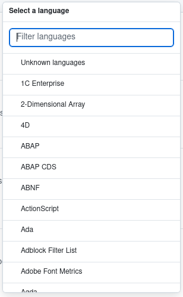

A syntax highlighter built on top of [frostybee/irosashi](https://github.com/frostybee/irosashi), with grammars taken from [wooorm/starry-night](https://github.com/wooorm/starry-night) and language definitions taken from [github-linguist/linguist](https://github.com/github-linguist/linguist).

## Highlighting

We needed a syntax highlighter optimized for our primary use case, a rich text editor:

- Fast loading / time-to-first-paint
- Highlighting on each keypress without dropping frames
- Ideally synchronously without WebWorkers to avoid having to deal with stale or flickering highlights
- High quality tokens, either Oniguruma or Tree-sitter grade

After trying probably a dozen different tools ranging from JavaScript to Rust, we currently settled on [frostybee/irosashi](https://github.com/frostybee/irosashi) and built a thin layer on top:

- Irosashi runs the same TextMate grammars as VS Code, with [Ferroni](https://github.com/sebastian-software/ferroni) as a port of Oniguruma for the regular expressions, compiled to WebAssembly
- The Rust port of Oniguruma has some minor differences to its C version, so we had to patch a few broken grammars
- Each grammar is its own chunk, fetched the first time a language that uses it is loaded, together with the grammars it embeds (sometimes syntax highlighters take 200ms to fetch all registered languages)
- The last input gets cached and for the most part only changed lines get retokenized, so a keypress in a large file goes from 21.8 ms down to 0.37 ms
- Instead of a color theme, scopes map to one of 23 token classes such as `keyword` or `string`, so the highlighter returns lengths and classes and you decide the colors

## Languages

For our products, we need fuzzy language detection and a language picker - both proved to be challenging, as we ship support for over 700 languages and tools, opening a popup showing all of them alphabetically sorted was bad UX.

For example consider Github's language picker in the trending repos:



- When opening the language picker, it should only show the most popular languages, optimizing for scrolling and clicking
- When using the search input inside that picker, it should now fuzzy match against all languages, but still prioritize popular ones

We took [github-linguist/linguist](https://github.com/github-linguist/linguist) as a baseline and made some tweaks:

- Removed all the languages for which we couldn't find grammar rules, which leaves 769 of Linguist's 836
- Tweaked capitalization in some titles, for example `fish` -> `Fish`
- Shortened some titles, for example `JSON with Comments` -> `JSONC`
- Some languages have conflicting file extensions, for example `cs` could mean Smalltalk or C#, but you probably meant the latter
- We marked languages and formats as popular or common by looking at developer surveys and different publicly available statistics
- Words like `text`, `txt` or `log` are not a language, so a ` ```text ` block stays plain

## Credits

- [frostybee/irosashi](https://github.com/frostybee/irosashi)
- [sebastian-software/ferroni](https://github.com/sebastian-software/ferroni)
- [wooorm/starry-night](https://github.com/wooorm/starry-night)
- [github-linguist/linguist](https://github.com/github-linguist/linguist)
